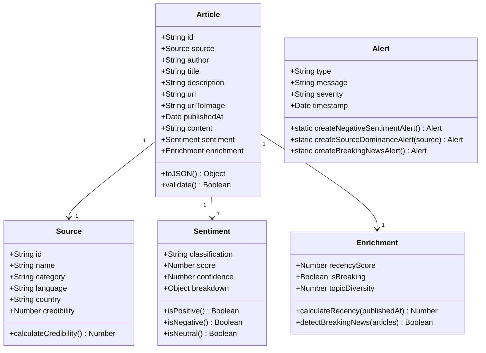
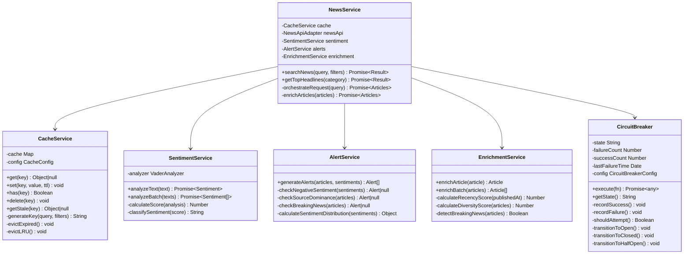

# Low-Level Design (LLD)
## News Aggregator with Sentiment Analysis System

**Version**: 1.0  
**Date**: 2026-07-29  
**Status**: Detailed Design Document

---

## 1. Introduction

This document provides detailed class diagrams, module specifications, algorithms, and implementation details for the News Aggregator with Sentiment Analysis system.

---

## 2. Backend Module Design

### 2.1 Project Structure

```
backend/
├── src/
│   ├── config/
│   │   ├── app.config.js           # Application configuration
│   │   ├── api.config.js           # API keys & endpoints
│   │   └── cache.config.js         # Cache settings
│   ├── controllers/
│   │   ├── newsController.js       # News endpoint handlers
│   │   ├── sourcesController.js    # Sources endpoint handlers
│   │   └── healthController.js     # Health check handlers
│   ├── services/
│   │   ├── newsService.js          # Core news logic
│   │   ├── sentimentService.js     # Sentiment analysis
│   │   ├── cacheService.js         # Cache operations
│   │   ├── alertService.js         # Alert generation
│   │   └── enrichmentService.js    # Data enrichment
│   ├── adapters/
│   │   ├── newsApiAdapter.js       # NewsAPI client
│   │   └── mockDataAdapter.js      # Mock data provider
│   ├── middleware/
│   │   ├── errorHandler.js         # Global error handling
│   │   ├── rateLimiter.js          # Rate limiting
│   │   ├── validator.js            # Request validation
│   │   └── logger.js               # Request logging
│   ├── models/
│   │   ├── Article.js              # Article data model
│   │   ├── Sentiment.js            # Sentiment data model
│   │   └── Alert.js                # Alert data model
│   ├── utils/
│   │   ├── circuitBreaker.js       # Circuit breaker implementation
│   │   ├── logger.js               # Winston logger
│   │   ├── validators.js           # Input validators
│   │   └── helpers.js              # Utility functions
│   ├── routes/
│   │   ├── index.js                # Route aggregator
│   │   ├── newsRoutes.js           # News endpoints
│   │   └── healthRoutes.js         # Health endpoints
│   └── app.js                      # Express app setup
├── tests/
│   ├── unit/
│   └── integration/
├── package.json
├── .env.example
└── server.js                   # Entry point
```

---

## 3. Class Diagrams

### 3.1 Core Classes



### 3.2 Service Layer Classes



---

## 4. Detailed Module Specifications

### 4.1 NewsService

#### Interface
```javascript
class NewsService {
  /**
   * Search news articles with caching and circuit breaker
   * @param {string} query - Search query
   * @param {Object} filters - Filter options
   * @param {Date} filters.from - Start date
   * @param {Date} filters.to - End date
   * @param {string[]} filters.sources - Source IDs
   * @param {string} filters.language - Language code
   * @param {string} filters.sortBy - Sort order
   * @param {number} filters.pageSize - Results per page
   * @param {number} filters.page - Page number
   * @param {boolean} filters.offline - Offline mode
   * @returns {Promise<NewsResult>}
   */
  async searchNews(query, filters = {}) {
    // Implementation
  }

  /**
   * Get top headlines by category
   * @param {string} category - Category (business, tech, etc.)
   * @param {string} country - Country code
   * @returns {Promise<NewsResult>}
   */
  async getTopHeadlines(category, country = 'us') {
    // Implementation
  }
}
```

#### Implementation
```javascript
const NewsService = {
  async searchNews(query, filters = {}) {
    // 1. Validate input
    this.validateSearchParams(query, filters);

    // 2. Generate cache key
    const cacheKey = this.generateCacheKey(query, filters);

    // 3. Check cache
    const cached = await this.cache.get(cacheKey);
    if (cached && !cached.isExpired) {
      return this.buildResponse(cached.data, { cache: 'HIT' });
    }

    // 4. Execute with circuit breaker
    try {
      const articles = await this.circuitBreaker.execute(async () => {
        if (filters.offline) {
          return await this.mockAdapter.getNews(query);
        }
        return await this.newsApi.fetchNews(query, filters);
      });

      // 5. Analyze sentiment
      const sentiments = await this.sentiment.analyzeBatch(
        articles.map(a => a.title + ' ' + a.description)
      );

      // 6. Enrich articles
      const enrichedArticles = articles.map((article, i) => ({
        ...article,
        sentiment: sentiments[i],
        enrichment: this.enrichment.enrichArticle(article)
      }));

      // 7. Generate alerts
      const alerts = this.alerts.generateAlerts(enrichedArticles, sentiments);

      // 8. Cache result
      await this.cache.set(cacheKey, { articles: enrichedArticles, alerts }, 900); // 15 min

      // 9. Build response
      return this.buildResponse({ articles: enrichedArticles, alerts }, { cache: 'MISS' });

    } catch (error) {
      // 10. Fallback to stale cache
      const stale = await this.cache.getStale(cacheKey);
      if (stale) {
        return this.buildResponse(stale.data, { 
          cache: 'STALE', 
          warning: 'Showing cached results - API unavailable' 
        });
      }
      throw error;
    }
  },

  validateSearchParams(query, filters) {
    if (!query || query.trim().length === 0) {
      throw new ValidationError('Query cannot be empty');
    }
    if (query.length > 500) {
      throw new ValidationError('Query too long (max 500 characters)');
    }
    if (filters.pageSize && (filters.pageSize < 1 || filters.pageSize > 100)) {
      throw new ValidationError('Page size must be between 1 and 100');
    }
  },

  generateCacheKey(query, filters) {
    const parts = [query];
    if (filters.sources) parts.push(`sources:${filters.sources.join(',')}`);
    if (filters.from) parts.push(`from:${filters.from}`);
    if (filters.sortBy) parts.push(`sort:${filters.sortBy}`);
    return `news:${parts.join(':')}`.toLowerCase();
  },

  buildResponse(data, metadata) {
    return {
      status: 'ok',
      totalResults: data.articles.length,
      articles: data.articles,
      alerts: data.alerts || [],
      metadata: {
        ...metadata,
        sentimentDistribution: this.calculateSentimentDistribution(data.articles),
        responseTime: Date.now() - this.requestStartTime
      },
      _links: this.buildHATEOASLinks(data.articles)
    };
  }
};
```

---

### 4.2 SentimentService

#### Implementation
```javascript
const vader = require('vader-sentiment');

class SentimentService {
  /**
   * Analyze sentiment of single text
   * @param {string} text - Text to analyze
   * @returns {Promise<Sentiment>}
   */
  async analyzeText(text) {
    if (!text || text.trim().length === 0) {
      return this.createNeutralSentiment();
    }

    const analysis = vader.SentimentIntensityAnalyzer.polarity_scores(text);
    
    return {
      classification: this.classifySentiment(analysis.compound),
      score: analysis.compound,
      confidence: this.calculateConfidence(analysis),
      breakdown: {
        positive: analysis.pos,
        negative: analysis.neg,
        neutral: analysis.neu
      }
    };
  }

  /**
   * Analyze sentiment for multiple texts in batch
   * @param {string[]} texts - Array of texts
   * @returns {Promise<Sentiment[]>}
   */
  async analyzeBatch(texts) {
    return Promise.all(texts.map(text => this.analyzeText(text)));
  }

  /**
   * Classify sentiment based on compound score
   * @private
   * @param {number} compound - VADER compound score (-1 to 1)
   * @returns {string} - 'positive', 'negative', or 'neutral'
   */
  classifySentiment(compound) {
    if (compound >= 0.05) return 'positive';
    if (compound <= -0.05) return 'negative';
    return 'neutral';
  }

  /**
   * Calculate confidence based on score magnitude
   * @private
   * @param {Object} analysis - VADER analysis result
   * @returns {number} - Confidence score (0-1)
   */
  calculateConfidence(analysis) {
    const magnitude = Math.abs(analysis.compound);
    const dominance = Math.max(analysis.pos, analysis.neg, analysis.neu);
    return (magnitude + dominance) / 2;
  }

  /**
   * Create neutral sentiment fallback
   * @private
   * @returns {Sentiment}
   */
  createNeutralSentiment() {
    return {
      classification: 'neutral',
      score: 0,
      confidence: 0,
      breakdown: { positive: 0, negative: 0, neutral: 1 }
    };
  }
}

module.exports = new SentimentService();
```

---

### 4.3 CacheService

#### Implementation
```javascript
class CacheService {
  constructor(config = {}) {
    this.cache = new Map();
    this.maxSize = config.maxSize || 1000;
    this.defaultTTL = config.defaultTTL || 900; // 15 minutes
    this.staleTTL = config.staleTTL || 3600; // 1 hour for stale
  }

  /**
   * Get value from cache
   * @param {string} key - Cache key
   * @returns {Object|null} - Cached value or null
   */
  get(key) {
    const entry = this.cache.get(key);
    if (!entry) return null;

    const now = Date.now();
    if (now > entry.expiresAt) {
      // Expired but within stale window
      if (now <= entry.staleExpiresAt) {
        entry.isStale = true;
        return entry;
      }
      // Completely expired
      this.cache.delete(key);
      return null;
    }

    entry.lastAccessed = now;
    entry.isStale = false;
    return entry;
  }

  /**
   * Set value in cache with TTL
   * @param {string} key - Cache key
   * @param {any} value - Value to cache
   * @param {number} ttl - Time to live in seconds
   */
  set(key, value, ttl = this.defaultTTL) {
    // Evict if cache is full
    if (this.cache.size >= this.maxSize && !this.cache.has(key)) {
      this.evictLRU();
    }

    const now = Date.now();
    this.cache.set(key, {
      value,
      createdAt: now,
      lastAccessed: now,
      expiresAt: now + (ttl * 1000),
      staleExpiresAt: now + (this.staleTTL * 1000),
      isStale: false
    });
  }

  /**
   * Check if key exists (even if expired)
   * @param {string} key - Cache key
   * @returns {boolean}
   */
  has(key) {
    return this.cache.has(key);
  }

  /**
   * Delete key from cache
   * @param {string} key - Cache key
   */
  delete(key) {
    this.cache.delete(key);
  }

  /**
   * Get stale value (expired but within stale window)
   * @param {string} key - Cache key
   * @returns {Object|null}
   */
  getStale(key) {
    const entry = this.cache.get(key);
    if (!entry) return null;

    const now = Date.now();
    if (now <= entry.staleExpiresAt) {
      entry.isStale = true;
      return entry;
    }

    this.cache.delete(key);
    return null;
  }

  /**
   * Evict least recently used entry
   * @private
   */
  evictLRU() {
    let lruKey = null;
    let lruTime = Infinity;

    for (const [key, entry] of this.cache.entries()) {
      if (entry.lastAccessed < lruTime) {
        lruTime = entry.lastAccessed;
        lruKey = key;
      }
    }

    if (lruKey) {
      this.cache.delete(lruKey);
    }
  }

  /**
   * Clear all cache entries
   */
  clear() {
    this.cache.clear();
  }

  /**
   * Get cache statistics
   * @returns {Object}
   */
  getStats() {
    let validCount = 0;
    let staleCount = 0;
    const now = Date.now();

    for (const entry of this.cache.values()) {
      if (now <= entry.expiresAt) {
        validCount++;
      } else if (now <= entry.staleExpiresAt) {
        staleCount++;
      }
    }

    return {
      size: this.cache.size,
      validEntries: validCount,
      staleEntries: staleCount,
      expiredEntries: this.cache.size - validCount - staleCount,
      maxSize: this.maxSize
    };
  }
}

module.exports = CacheService;
```

---

### 4.4 CircuitBreaker

#### State Machine
```
CLOSED ──[failures >= threshold]──> OPEN
  ↑                                    │
  │                                    │ [timeout expires]
  │                                    ▼
  └─────[success]─────────── HALF-OPEN
                                     │
                                     │ [failure]
                                     ▼
                                   OPEN
```

#### Implementation
```javascript
const EventEmitter = require('events');

class CircuitBreaker extends EventEmitter {
  constructor(config = {}) {
    super();
    this.state = 'CLOSED';
    this.failureCount = 0;
    this.successCount = 0;
    this.lastFailureTime = null;
    this.nextAttemptTime = null;
    
    this.config = {
      failureThreshold: config.failureThreshold || 5,
      successThreshold: config.successThreshold || 2,
      timeout: config.timeout || 5000,
      resetTimeout: config.resetTimeout || 60000,
      fallback: config.fallback || null
    };
  }

  /**
   * Execute function with circuit breaker
   * @param {Function} fn - Async function to execute
   * @returns {Promise<any>}
   */
  async execute(fn) {
    if (!this.shouldAttempt()) {
      this.emit('reject', { state: this.state });
      
      if (this.config.fallback) {
        return await this.config.fallback();
      }
      
      throw new Error(`Circuit breaker is ${this.state}`);
    }

    try {
      const result = await this.executeWithTimeout(fn);
      this.recordSuccess();
      return result;
    } catch (error) {
      this.recordFailure();
      throw error;
    }
  }

  /**
   * Execute function with timeout
   * @private
   */
  async executeWithTimeout(fn) {
    return Promise.race([
      fn(),
      new Promise((_, reject) => 
        setTimeout(() => reject(new Error('Timeout')), this.config.timeout)
      )
    ]);
  }

  /**
   * Check if request should be attempted
   * @private
   * @returns {boolean}
   */
  shouldAttempt() {
    if (this.state === 'CLOSED') return true;
    
    if (this.state === 'OPEN') {
      const now = Date.now();
      if (now >= this.nextAttemptTime) {
        this.transitionToHalfOpen();
        return true;
      }
      return false;
    }
    
    if (this.state === 'HALF-OPEN') {
      return true;
    }
    
    return false;
  }

  /**
   * Record successful execution
   * @private
   */
  recordSuccess() {
    this.failureCount = 0;
    
    if (this.state === 'HALF-OPEN') {
      this.successCount++;
      if (this.successCount >= this.config.successThreshold) {
        this.transitionToClosed();
      }
    }
    
    this.emit('success', { state: this.state });
  }

  /**
   * Record failed execution
   * @private
   */
  recordFailure() {
    this.failureCount++;
    this.lastFailureTime = Date.now();
    
    if (this.state === 'HALF-OPEN') {
      this.transitionToOpen();
    } else if (this.failureCount >= this.config.failureThreshold) {
      this.transitionToOpen();
    }
    
    this.emit('failure', { 
      state: this.state, 
      failureCount: this.failureCount 
    });
  }

  /**
   * Transition to CLOSED state
   * @private
   */
  transitionToClosed() {
    this.state = 'CLOSED';
    this.failureCount = 0;
    this.successCount = 0;
    this.nextAttemptTime = null;
    this.emit('stateChange', { from: this.state, to: 'CLOSED' });
  }

  /**
   * Transition to OPEN state
   * @private
   */
  transitionToOpen() {
    this.state = 'OPEN';
    this.successCount = 0;
    this.nextAttemptTime = Date.now() + this.config.resetTimeout;
    this.emit('stateChange', { from: this.state, to: 'OPEN' });
  }

  /**
   * Transition to HALF-OPEN state
   * @private
   */
  transitionToHalfOpen() {
    this.state = 'HALF-OPEN';
    this.successCount = 0;
    this.emit('stateChange', { from: this.state, to: 'HALF-OPEN' });
  }

  /**
   * Get current state
   * @returns {string}
   */
  getState() {
    return this.state;
  }

  /**
   * Get circuit breaker metrics
   * @returns {Object}
   */
  getMetrics() {
    return {
      state: this.state,
      failureCount: this.failureCount,
      successCount: this.successCount,
      lastFailureTime: this.lastFailureTime,
      nextAttemptTime: this.nextAttemptTime
    };
  }
}

module.exports = CircuitBreaker;
```

---

### 4.5 AlertService

#### Implementation
```javascript
class AlertService {
  /**
   * Generate alerts based on article analysis
   * @param {Article[]} articles - Articles with sentiment
   * @param {Sentiment[]} sentiments - Sentiment analysis results
   * @returns {Alert[]}
   */
  generateAlerts(articles, sentiments) {
    const alerts = [];

    // Check negative sentiment
    const negativeSentimentAlert = this.checkNegativeSentiment(sentiments);
    if (negativeSentimentAlert) alerts.push(negativeSentimentAlert);

    // Check source dominance
    const sourceDominanceAlert = this.checkSourceDominance(articles);
    if (sourceDominanceAlert) alerts.push(sourceDominanceAlert);

    // Check breaking news
    const breakingNewsAlert = this.checkBreakingNews(articles);
    if (breakingNewsAlert) alerts.push(breakingNewsAlert);

    // Check low credibility
    const credibilityAlert = this.checkLowCredibility(articles);
    if (credibilityAlert) alerts.push(credibilityAlert);

    // Check sentiment variance
    const varianceAlert = this.checkSentimentVariance(sentiments);
    if (varianceAlert) alerts.push(varianceAlert);

    return alerts;
  }

  /**
   * Check for high negative sentiment
   * @private
   */
  checkNegativeSentiment(sentiments) {
    const negativeCount = sentiments.filter(s => s.classification === 'negative').length;
    const negativePercentage = negativeCount / sentiments.length;

    if (negativePercentage > 0.6) {
      return {
        type: 'warning',
        message: 'High volume of negative news - Content may be distressing',
        severity: 'medium',
        metadata: { negativePercentage: (negativePercentage * 100).toFixed(0) + '%' }
      };
    }
    return null;
  }

  /**
   * Check for source dominance
   * @private
   */
  checkSourceDominance(articles) {
    const sourceCounts = {};
    articles.forEach(article => {
      const sourceName = article.source.name;
      sourceCounts[sourceName] = (sourceCounts[sourceName] || 0) + 1;
    });

    for (const [source, count] of Object.entries(sourceCounts)) {
      const percentage = count / articles.length;
      if (percentage > 0.5) {
        return {
          type: 'info',
          message: `Results dominated by ${source} - Consider diversifying sources`,
          severity: 'low',
          metadata: { source, percentage: (percentage * 100).toFixed(0) + '%' }
        };
      }
    }
    return null;
  }

  /**
   * Check for breaking news
   * @private
   */
  checkBreakingNews(articles) {
    const twoHoursAgo = Date.now() - (2 * 60 * 60 * 1000);
    const recentCount = articles.filter(a => 
      new Date(a.publishedAt).getTime() > twoHoursAgo
    ).length;
    const recentPercentage = recentCount / articles.length;

    if (recentPercentage > 0.3) {
      return {
        type: 'info',
        message: 'High volume of recent articles - Breaking news detected',
        severity: 'low',
        metadata: { recentPercentage: (recentPercentage * 100).toFixed(0) + '%' }
      };
    }
    return null;
  }

  /**
   * Check for low credibility sources
   * @private
   */
  checkLowCredibility(articles) {
    const avgCredibility = articles.reduce((sum, a) => 
      sum + (a.source.credibility || 0.5), 0
    ) / articles.length;

    if (avgCredibility < 0.5) {
      return {
        type: 'warning',
        message: 'Some sources may have low credibility - Verify information',
        severity: 'medium',
        metadata: { avgCredibility: avgCredibility.toFixed(2) }
      };
    }
    return null;
  }

  /**
   * Check for sentiment variance (controversial topics)
   * @private
   */
  checkSentimentVariance(sentiments) {
    const scores = sentiments.map(s => s.score);
    const mean = scores.reduce((a, b) => a + b, 0) / scores.length;
    const variance = scores.reduce((sum, score) => 
      sum + Math.pow(score - mean, 2), 0
    ) / scores.length;
    const stdDev = Math.sqrt(variance);

    if (stdDev > 0.4) {
      return {
        type: 'info',
        message: 'Mixed sentiment detected - Topic may be controversial',
        severity: 'low',
        metadata: { stdDev: stdDev.toFixed(2) }
      };
    }
    return null;
  }
}

module.exports = new AlertService();
```

---

## 5. API Route Handlers

### 5.1 News Routes

```javascript
const express = require('express');
const router = express.Router();
const newsController = require('../controllers/newsController');
const { validateSearchQuery } = require('../middleware/validator');
const rateLimiter = require('../middleware/rateLimiter');

/**
 * @route GET /api/v1/news
 * @desc Search news articles
 * @access Public
 */
router.get(
  '/news',
  rateLimiter({ max: 100, windowMs: 3600000 }), // 100 req/hour
  validateSearchQuery,
  newsController.searchNews
);

/**
 * @route GET /api/v1/headlines
 * @desc Get top headlines
 * @access Public
 */
router.get(
  '/headlines',
  rateLimiter({ max: 50, windowMs: 3600000 }),
  newsController.getHeadlines
);

/**
 * @route GET /api/v1/sources
 * @desc Get available sources
 * @access Public
 */
router.get(
  '/sources',
  rateLimiter({ max: 20, windowMs: 3600000 }),
  newsController.getSources
);

module.exports = router;
```

### 5.2 News Controller

```javascript
const newsService = require('../services/newsService');
const logger = require('../utils/logger');

class NewsController {
  /**
   * Handle news search request
   */
  async searchNews(req, res, next) {
    try {
      const { q: query, from, to, sources, language, sortBy, pageSize, page, offline } = req.query;

      const filters = {
        from,
        to,
        sources: sources ? sources.split(',') : undefined,
        language,
        sortBy: sortBy || 'publishedAt',
        pageSize: parseInt(pageSize) || 20,
        page: parseInt(page) || 1,
        offline: offline === 'true'
      };

      const result = await newsService.searchNews(query, filters);

      // Set cache headers
      if (result.metadata.cache === 'HIT') {
        res.set('X-Cache', 'HIT');
      } else if (result.metadata.cache === 'STALE') {
        res.set('X-Cache', 'STALE');
        res.set('X-Warning', result.metadata.warning);
      } else {
        res.set('X-Cache', 'MISS');
      }

      res.set('X-Response-Time', result.metadata.responseTime + 'ms');

      res.json(result);
    } catch (error) {
      logger.error('Error in searchNews controller:', error);
      next(error);
    }
  }

  /**
   * Handle top headlines request
   */
  async getHeadlines(req, res, next) {
    try {
      const { category, country } = req.query;
      const result = await newsService.getTopHeadlines(category, country);
      res.json(result);
    } catch (error) {
      logger.error('Error in getHeadlines controller:', error);
      next(error);
    }
  }

  /**
   * Handle sources request
   */
  async getSources(req, res, next) {
    try {
      const { category, language, country } = req.query;
      const result = await newsService.getSources({ category, language, country });
      res.json(result);
    } catch (error) {
      logger.error('Error in getSources controller:', error);
      next(error);
    }
  }
}

module.exports = new NewsController();
```

---

## 6. Middleware Components

### 6.1 Rate Limiter

```javascript
const rateLimit = require('express-rate-limit');
const RedisStore = require('rate-limit-redis');
const redis = require('redis');

const createRateLimiter = (options = {}) => {
  const config = {
    windowMs: options.windowMs || 15 * 60 * 1000, // 15 minutes
    max: options.max || 100, // Max requests
    message: {
      status: 'error',
      message: 'Too many requests, please try again later',
      retryAfter: options.windowMs / 1000
    },
    standardHeaders: true,
    legacyHeaders: false,
    handler: (req, res) => {
      res.status(429).json(config.message);
    }
  };

  // Use Redis store in production
  if (process.env.NODE_ENV === 'production' && process.env.REDIS_URL) {
    const client = redis.createClient({ url: process.env.REDIS_URL });
    config.store = new RedisStore({ client });
  }

  return rateLimit(config);
};

module.exports = createRateLimiter;
```

### 6.2 Request Validator

```javascript
const Joi = require('joi');

const searchQuerySchema = Joi.object({
  q: Joi.string().min(1).max(500).required(),
  from: Joi.date().iso().optional(),
  to: Joi.date().iso().optional(),
  sources: Joi.string().optional(),
  language: Joi.string().length(2).optional(),
  sortBy: Joi.string().valid('relevancy', 'popularity', 'publishedAt').optional(),
  pageSize: Joi.number().integer().min(1).max(100).optional(),
  page: Joi.number().integer().min(1).optional(),
  offline: Joi.boolean().optional()
});

const validateSearchQuery = (req, res, next) => {
  const { error } = searchQuerySchema.validate(req.query);
  
  if (error) {
    return res.status(400).json({
      status: 'error',
      message: 'Validation error',
      details: error.details.map(d => d.message)
    });
  }
  
  next();
};

module.exports = { validateSearchQuery };
```

### 6.3 Error Handler

```javascript
const logger = require('../utils/logger');

const errorHandler = (err, req, res, next) => {
  logger.error('Error:', {
    message: err.message,
    stack: err.stack,
    url: req.url,
    method: req.method
  });

  // Validation errors
  if (err.name === 'ValidationError') {
    return res.status(400).json({
      status: 'error',
      message: err.message
    });
  }

  // Circuit breaker errors
  if (err.message.includes('Circuit breaker')) {
    return res.status(503).json({
      status: 'error',
      message: 'Service temporarily unavailable',
      circuitBreaker: 'OPEN'
    });
  }

  // External API errors
  if (err.response && err.response.status) {
    return res.status(502).json({
      status: 'error',
      message: 'External service error',
      details: err.response.data
    });
  }

  // Default server error
  res.status(500).json({
    status: 'error',
    message: process.env.NODE_ENV === 'production' 
      ? 'Internal server error' 
      : err.message
  });
};

module.exports = errorHandler;
```

---

## 7. Database Schema (Optional - Future Enhancement)

```sql
-- Users table
CREATE TABLE users (
  id UUID PRIMARY KEY DEFAULT gen_random_uuid(),
  email VARCHAR(255) UNIQUE NOT NULL,
  password_hash VARCHAR(255) NOT NULL,
  created_at TIMESTAMP DEFAULT NOW(),
  updated_at TIMESTAMP DEFAULT NOW()
);

-- Saved searches
CREATE TABLE saved_searches (
  id UUID PRIMARY KEY DEFAULT gen_random_uuid(),
  user_id UUID REFERENCES users(id) ON DELETE CASCADE,
  query VARCHAR(500) NOT NULL,
  filters JSONB,
  name VARCHAR(100),
  created_at TIMESTAMP DEFAULT NOW()
);

-- User preferences
CREATE TABLE user_preferences (
  user_id UUID PRIMARY KEY REFERENCES users(id) ON DELETE CASCADE,
  alert_thresholds JSONB,
  default_filters JSONB,
  notification_settings JSONB,
  updated_at TIMESTAMP DEFAULT NOW()
);

-- Article history (for recommendations)
CREATE TABLE article_views (
  id UUID PRIMARY KEY DEFAULT gen_random_uuid(),
  user_id UUID REFERENCES users(id) ON DELETE CASCADE,
  article_url VARCHAR(500) NOT NULL,
  viewed_at TIMESTAMP DEFAULT NOW(),
  sentiment VARCHAR(20),
  source VARCHAR(100)
);

CREATE INDEX idx_article_views_user ON article_views(user_id, viewed_at DESC);
```

---

## 8. Testing Strategy

### 8.1 Unit Tests

```javascript
// tests/unit/sentimentService.test.js
const sentimentService = require('../../src/services/sentimentService');

describe('SentimentService', () => {
  describe('analyzeText', () => {
    it('should classify positive sentiment correctly', async () => {
      const text = 'This is amazing and wonderful news!';
      const result = await sentimentService.analyzeText(text);
      
      expect(result.classification).toBe('positive');
      expect(result.score).toBeGreaterThan(0.05);
      expect(result.confidence).toBeGreaterThan(0);
    });

    it('should classify negative sentiment correctly', async () => {
      const text = 'This is terrible and awful news.';
      const result = await sentimentService.analyzeText(text);
      
      expect(result.classification).toBe('negative');
      expect(result.score).toBeLessThan(-0.05);
    });

    it('should handle empty text gracefully', async () => {
      const result = await sentimentService.analyzeText('');
      
      expect(result.classification).toBe('neutral');
      expect(result.score).toBe(0);
    });
  });
});
```

### 8.2 Integration Tests

```javascript
// tests/integration/newsApi.test.js
const request = require('supertest');
const app = require('../../src/app');

describe('GET /api/v1/news', () => {
  it('should return news articles for valid query', async () => {
    const response = await request(app)
      .get('/api/v1/news')
      .query({ q: 'technology' })
      .expect(200);

    expect(response.body.status).toBe('ok');
    expect(response.body.articles).toBeInstanceOf(Array);
    expect(response.body.articles.length).toBeGreaterThan(0);
    expect(response.headers['x-cache']).toBeDefined();
  });

  it('should return 400 for missing query', async () => {
    const response = await request(app)
      .get('/api/v1/news')
      .expect(400);

    expect(response.body.status).toBe('error');
  });

  it('should respect rate limits', async () => {
    // Make requests up to limit
    for (let i = 0; i < 100; i++) {
      await request(app).get('/api/v1/news').query({ q: 'test' });
    }

    // 101st request should be rate limited
    const response = await request(app)
      .get('/api/v1/news')
      .query({ q: 'test' })
      .expect(429);

    expect(response.body.message).toContain('Too many requests');
  });
});
```

---

## 9. Configuration Files

### 9.1 Environment Variables

```bash
# .env.example
NODE_ENV=development
PORT=3000

# NewsAPI
NEWS_API_KEY=your_api_key_here
NEWS_API_BASE_URL=https://newsapi.org/v2

# Cache
CACHE_MAX_SIZE=1000
CACHE_DEFAULT_TTL=900
CACHE_STALE_TTL=3600

# Circuit Breaker
CIRCUIT_FAILURE_THRESHOLD=5
CIRCUIT_SUCCESS_THRESHOLD=2
CIRCUIT_TIMEOUT=5000
CIRCUIT_RESET_TIMEOUT=60000

# Rate Limiting
RATE_LIMIT_WINDOW_MS=3600000
RATE_LIMIT_MAX=100

# Redis (optional)
REDIS_URL=redis://localhost:6379

# Logging
LOG_LEVEL=info
```

---

## 10. Performance Optimizations

### 10.1 Response Compression
```javascript
const compression = require('compression');
app.use(compression());
```

### 10.2 Async Batch Processing
```javascript
// Process sentiment analysis in parallel
const sentiments = await Promise.all(
  articles.map(article => 
    sentimentService.analyzeText(article.title + ' ' + article.description)
  )
);
```

### 10.3 Database Query Optimization
```javascript
// Use connection pooling
const pool = new Pool({
  max: 20,
  idleTimeoutMillis: 30000,
  connectionTimeoutMillis: 2000
});
```

---

## Appendix: Algorithm Pseudocode

### Cache Key Generation
```
function generateCacheKey(query, filters):
  parts = [normalize(query)]
  
  if filters.sources exists:
    parts.append("sources:" + sort(filters.sources).join(","))
  
  if filters.from exists:
    parts.append("from:" + formatDate(filters.from))
  
  if filters.sortBy exists:
    parts.append("sort:" + filters.sortBy)
  
  return "news:" + parts.join(":").toLowerCase()
```

### Sentiment Classification
```
function classifySentiment(compoundScore):
  if compoundScore >= 0.05:
    return "positive"
  else if compoundScore <= -0.05:
    return "negative"
  else:
    return "neutral"
```

### LRU Eviction
```
function evictLRU():
  lruEntry = null
  lruTime = INFINITY
  
  for each entry in cache:
    if entry.lastAccessed < lruTime:
      lruTime = entry.lastAccessed
      lruEntry = entry
  
  if lruEntry exists:
    cache.delete(lruEntry.key)
```

---

**Document Owner**: Engineering Team  
**Last Updated**: 2026-07-29  
**Version**: 1.0  
**Status**: Ready for Implementation ✅
